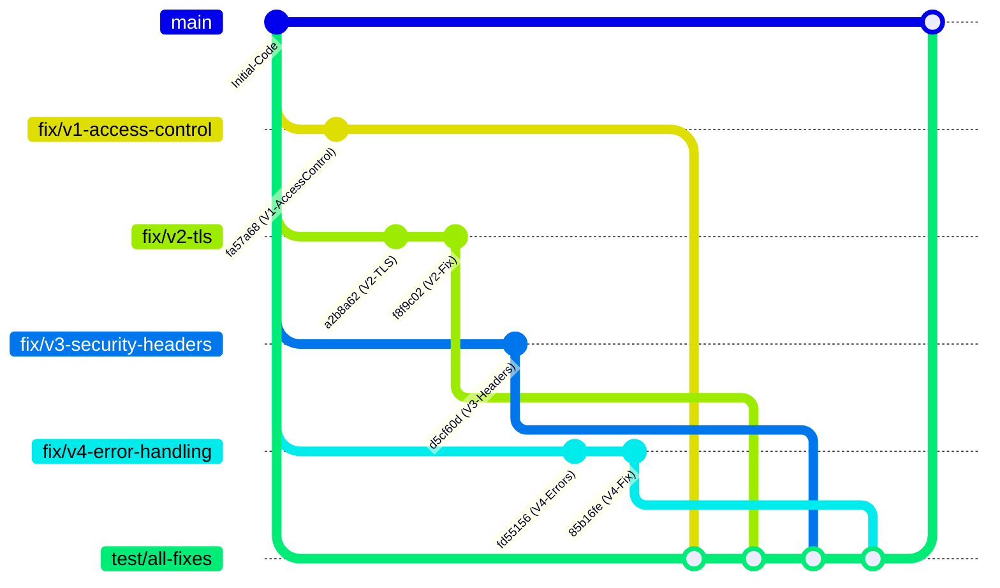

# Bastionado y Mitigación de Vulnerabilidades en OWASP WebGoat

[](https://jdk.java.net/)
[](https://spring.io/projects/spring-boot)
[](https://owasp.org/Top10/)
[-blue.svg)](#validación-y-pruebas)
[](https://conventionalcommits.org)

Este repositorio contiene la implementación técnica de bastionado de seguridad (*Security Hardening*) sobre la infraestructura de **OWASP WebGoat**, desarrollada como proyecto final para la asignatura de **Hacking Ético**.

El objetivo central consistió en diseñar, implementar, probar y documentar la mitigación de cuatro vulnerabilidades críticas descubiertas durante la auditoría inicial de seguridad del aplicativo, confinando las correcciones exclusivamente a la infraestructura del contenedor (`org.owasp.webgoat.container`) y preservando la integridad didáctica de las lecciones deliberadamente vulnerables.

---

## Matriz Resumen de Vulnerabilidades Mitigadas

| ID | Vulnerabilidad | Clasificación CWE / OWASP | Componentes / Archivos Afectados | Técnica Defensiva Implementada |
| :--- | :--- | :--- | :--- | :--- |
| **V1** | **Autorización Faltante en `/WebGoat/service/debug/labels.mvc`** | **CWE-862**<br>OWASP A01:2021 | `WebSecurityConfig.java`<br>`LabelDebugService.java` | Restricción de `/service/debug/**` al rol `WEBGOAT_ADMIN` en Spring Security (`SecurityFilterChain`) y defensa en profundidad con `@PreAuthorize("hasAuthority('WEBGOAT_ADMIN')")` sobre `LabelDebugService`. |
| **V2** | **Transmisión en Texto Plano y Cookies Inseguras** | **CWE-319**<br>OWASP A02:2021 | `application-webgoat.properties`<br>`goatkeystore.pkcs12`<br>`WebSecurityConfig.java` | Forzado de cifrado en tránsito TLSv1.2/1.3 con suites AEAD GCM en Tomcat, rechazo de texto plano y atributos `Secure`, `HttpOnly` y `SameSite=Lax` en `JSESSIONID`. |
| **V3** | **Ausencia de Cabeceras Defensivas HTTP** | **CWE-693**<br>OWASP A05:2021 | `WebSecurityConfig.java` | Reconfiguración de Spring Security inyectando `HSTS` (31536000 s), `X-Frame-Options: DENY`, `X-Content-Type-Options: nosniff`, `CSP` y `Referrer-Policy`. |
| **V4** | **Fuga de Información Sensible en Errores** | **CWE-209**<br>OWASP A05:2021 | `GlobalExceptionHandler.java`<br>`application-webgoat.properties`<br>`error.html` | Supresión de stack traces en configuración (`include-stacktrace=never`) y `@ControllerAdvice` que desvía diagnósticos a logs internos y responde con JSON/HTML limpios. |

---

## Detalle Técnico de las Soluciones

### V1 — Control de Acceso Basado en Roles en Servicio Global de Depuración (CWE-862)
* **Causa Raíz:** En `WebSecurityConfig.java`, la autoridad `WEBGOAT_ADMIN` restringía únicamente `/service/admin/**`, dejando `/WebGoat/service/debug/labels.mvc` bajo `.anyRequest().authenticated()`. Además, `LabelDebugService.java` carecía de `@PreAuthorize` y permitía consultar o modificar el bean singleton compartido `LabelDebugger` mediante peticiones `GET` desde cualquier cuenta estándar.
* **Solución Implementada:**
  1. Se restringió `/service/debug/**` en `WebSecurityConfig.java` exigiendo `.hasAuthority("WEBGOAT_ADMIN")`.
  2. Se reforzó `LabelDebugService.java` con `@PreAuthorize("hasAuthority('WEBGOAT_ADMIN')")` aprovechando `@EnableMethodSecurity`.
  3. Toda solicitud anónima (`302` hacia `/login`) o autenticada sin privilegios (`HTTP 403 Forbidden` en JSON) queda rechazada sin alterar `LabelDebugger`, manteniendo operativos el acceso `WEBGOAT_ADMIN` y el endpoint público `/service/labels.mvc`.
  4. Se implementó la suite `LabelDebugAccessControlTest.java` (9 casos cubriendo filtro HTTP, seguridad por método, acceso administrativo y `/service/labels.mvc`).

### V2 — Cifrado en Tránsito y Endurecimiento de Sesión (CWE-319)
* **Causa Raíz:** WebGoat iniciaba por defecto en HTTP sin cifrar sobre el puerto 8080 y emitía la cookie `JSESSIONID` sin flags de protección.
* **Solución Implementada:**
  1. Se habilitó el conector SSL en `application-webgoat.properties` (`server.ssl.enabled=true`) vinculado al almacén de claves PKCS12 `goatkeystore.pkcs12`.
  2. Se restringieron los protocolos exclusivamente a `TLSv1.2` y `TLSv1.3` con suites criptográficas robustas `TLS_ECDHE_RSA_WITH_AES_128_GCM_SHA256` y `TLS_ECDHE_RSA_WITH_AES_256_GCM_SHA384`.
  3. Se endureció la cookie de sesión mediante las directivas:
     ```properties
     server.servlet.session.cookie.secure=true
     server.servlet.session.cookie.http-only=true
     server.servlet.session.cookie.same-site=lax
     ```
  4. Las solicitudes HTTP no cifradas son rechazadas inmediatamente a nivel de socket con `HTTP 400 Bad Request`.

### V3 — Inyección de Cabeceras Defensivas HTTP (CWE-693)
* **Causa Raíz:** La clase de seguridad `WebSecurityConfig.java` contenía la directiva `headers.disable()`, anulando todas las defensas del navegador.
* **Solución Implementada:** Se reestructuró la cadena de filtros de Spring Security 7 activando el DSL de cabeceras defensivas:
  - `Strict-Transport-Security: max-age=31536000 ; includeSubDomains` (HSTS durante 1 año).
  - `X-Frame-Options: DENY` (Mitigación total contra Clickjacking / UI Redressing).
  - `X-Content-Type-Options: nosniff` (Protección estricta contra ataques de MIME Sniffing).
  - `Referrer-Policy: strict-origin-when-cross-origin` (Prevención de fuga de rutas sensibles).
  - `Content-Security-Policy: default-src 'self'; script-src 'self' 'unsafe-inline' 'unsafe-eval'; style-src 'self' 'unsafe-inline'; img-src 'self' data:; font-src 'self' data:; connect-src 'self'` (Defensa en profundidad contra XSS e inyecciones no confiables).

### V4 — Supresión de Stack Traces y Manejo de Errores Desacoplado (CWE-209)
* **Causa Raíz:** `application-webgoat.properties` forzaba `include-stacktrace=always`, exponiendo volcados de clases de Java y Spring ante cualquier error 404 o 500.
* **Solución Implementada:**
  1. Se eliminó la directiva vulnerable y se configuró la supresión radical en propiedades:
     ```properties
     server.error.include-stacktrace=never
     server.error.include-message=never
     server.error.include-binding-errors=never
     server.error.include-exception=false
     server.error.whitelabel.enabled=false
     ```
  2. Se creó el controlador `GlobalExceptionHandler` anotado con `@ControllerAdvice`.
  3. Desacoplamiento de responsabilidades: los diagnósticos técnicos completos se registran exclusivamente en los archivos de log del servidor con `log.error()`, mientras que al cliente se le entrega una respuesta sanitizada.
  4. Soporte híbrido: detecta si la petición proviene de una API (`Accept: application/json`) para devolver un JSON limpio o de un navegador (`Accept: text/html`) devolviendo la plantilla `error.html` diseñada con estilos limpios sin volcados JVM.

---

## Estrategia de Ramas en Git y Trazabilidad

Se implementó una estrategia **Git Flow** con ramas aisladas para mantener la separación de responsabilidades y permitir la revisión independiente de cada solución:



### Tabla de Commits de Seguridad

| Hash | Rama | Tipo | Mensaje de Commit | Autor |
| :--- | :--- | :--- | :--- | :--- |
| `fa57a68` | `fix/v1-access-control` | `fix(security)` | restrict /service/debug/** to WEBGOAT_ADMIN (V1) | Diego Castro |
| `a2b8a62` | `fix/v2-tls` | `feat(security)` | enforce TLS encryption and secure cookie flags for WebGoat transport (V2) | Diego Castro |
| `f8f9c02` | `fix/v2-tls` | `fix(security)` | rely on native container SSL and avoid deprecated channel filter | Diego Castro |
| `d5cf60d` | `fix/v3-security-headers` | `fix(security)` | enable defensive HTTP headers (CSP, HSTS, XFO, nosniff) in WebSecurityConfig (V3) | Diego Castro |
| `fd55156` | `fix/v4-error-handling` | `fix(security)` | suppress stack trace leakage and implement GlobalExceptionHandler (V4) | Diego Castro |
| `85b16fe` | `fix/v4-error-handling` | `style(security)`| apply spotless formatting and fix test signatures | Diego Castro |

---

## Guía de Despliegue y Ejecución

> [!NOTE]
> WebGoat utiliza **Java 25**. Para asegurar reproducibilidad inmediata en cualquier estación de trabajo sin requerir la instalación manual de JDK 25 en el sistema operativo anfitrión, el entorno se compila y ejecuta mediante el contenedor oficial **Eclipse Temurin 25**.

### 1. Clonar el repositorio y posicionarse en la rama principal o unificada
```bash
git clone https://github.com/dacastro125/Some-WebGoat-Security-Fixes.git
cd Some-WebGoat-Security-Fixes
git checkout main
```

### 2. Compilar el artefacto (.jar)
```bash
docker run --rm -v "${PWD}:/app" -v "${HOME}/.m2:/root/.m2" -w /app eclipse-temurin:25-jdk-noble ./mvnw clean package -DskipTests
```

### 3. Iniciar el servidor WebGoat
Mapeamos el puerto HTTPS al **`8443`** para evitar colisiones con el puerto por defecto de Burp Suite (`8080`):

```bash
docker run --name webgoat-live --rm -d \
  -p 8443:8080 -p 9090:9090 \
  -v "${PWD}/target:/home/webgoat" -w /home/webgoat \
  eclipse-temurin:25-jdk-noble java \
  "-Duser.home=/home/webgoat" "-Dfile.encoding=UTF-8" \
  --add-opens java.base/java.lang=ALL-UNNAMED \
  --add-opens java.base/java.util=ALL-UNNAMED \
  --add-opens java.base/java.lang.reflect=ALL-UNNAMED \
  --add-opens java.base/java.text=ALL-UNNAMED \
  --add-opens java.desktop/java.beans=ALL-UNNAMED \
  --add-opens java.desktop/java.awt.font=ALL-UNNAMED \
  --add-opens java.base/sun.nio.ch=ALL-UNNAMED \
  --add-opens java.base/java.io=ALL-UNNAMED \
  "-Drunning.in.docker=true" \
  -jar webgoat-2026.6-SNAPSHOT.jar --server.address=0.0.0.0
```

### 4. Acceso y Credenciales
- **URL WebGoat:** [https://localhost:8443/WebGoat](https://localhost:8443/WebGoat) *(aceptar la advertencia del certificado autofirmado local)*.
- **URL WebWolf:** [http://localhost:9090/WebWolf](http://localhost:9090/WebWolf)
- **Credenciales del Sistema:**
  - **Usuario Estándar:** `webgoat-user` | Contraseña: `webgoat`
  - **Usuario Administrador:** `webgoat-admin` | Contraseña: `webgoat`

### 5. Detener el servidor
```bash
docker stop webgoat-live
```

---

## Validación y Pruebas

### 1. Pruebas Unitarias y de Integración Automatizadas
Se desarrollaron 4 suites específicas para las vulnerabilidades mitigadas (**22 casos en total**), ejecutables con Maven Surefire:

```bash
docker run --rm -v "${PWD}:/app" -v "${HOME}/.m2:/root/.m2" -w /app eclipse-temurin:25-jdk-noble ./mvnw test "-Dtest=LabelDebugAccessControlTest,TransportSecurityTest,SecurityHeadersTest,GlobalExceptionHandlerTest"
```

- `LabelDebugAccessControlTest` (**9/9** aprobadas en `fix/v1-access-control`, **25/25** junto con `LabelDebuggerTest` [5] y `AdminControllerTest` [11]).
- `TransportSecurityTest` (**3** casos), `SecurityHeadersTest` (**5** casos) y `GlobalExceptionHandlerTest` (**5** casos) integradas desde `fix/v2-tls`, `fix/v3-security-headers` y `fix/v4-error-handling`.

### 2. Verificación Dinámica en Vivo con Burp Suite
* **V1 (Control de Acceso - CWE-862):** Al enviar `GET /WebGoat/service/debug/labels.mvc?enabled=true` con una sesión estándar (`usuarioprueba1` / `webgoat-user`), el servidor responde `HTTP/1.1 403` en JSON (`"error":"Forbidden"`) sin modificar `LabelDebugger`, mientras `webgoat-admin` conserva `200 OK` y `/WebGoat/service/labels.mvc` responde `200 OK`.
* **V2 (TLS & Cookie):** Al iniciar sesión (`POST /WebGoat/login`), la respuesta emite `Set-Cookie: JSESSIONID=...; Path=/WebGoat; Secure; HttpOnly; SameSite=Lax`. Las peticiones en texto plano por puerto HTTP son rechazadas con `HTTP 400`.
* **V3 (Cabeceras):** Se corroboró la inyección en todas las respuestas de `HSTS`, `X-Frame-Options: DENY`, `X-Content-Type-Options: nosniff` y `CSP`.
* **V4 (Manejo de Errores):** Al enviar peticiones a rutas inexistentes (`GET /WebGoat/recurso_inexistente_auditoria`), el servidor devuelve `HTTP/1.1 404 Not Found` en JSON y HTML completamente limpios, con **cero volcados de stack traces de la JVM**.

---

## Equipo de Trabajo y Aportes

| Integrante | Área / Vulnerabilidad Liderada |
| :--- | :--- |
| **Danilo** | **V1:** Control de Acceso Basado en Roles (`WEBGOAT_ADMIN`) en `/service/debug/labels.mvc` (CWE-862) sobre `WebSecurityConfig` y `LabelDebugService`. |
| **Diego Castro** | **V2:** Cifrado de Transporte TLS y Endurecimiento de Cookies de Sesión (CWE-319) e integración general. |
| **Cristian** | **V3:** Inyección de Cabeceras Defensivas HTTP y Seguridad del Protocolo (CWE-693). |
| **Bonilla** | **V4:** Supresión de Fuga de Información en Errores y Controlador Global (CWE-209). |

---

> [!IMPORTANT]
> **Aviso de Responsabilidad Ética:** Este proyecto fue desarrollado con propósitos académicos y de investigación en seguridad informática. El análisis y las pruebas de penetración se realizaron de manera controlada y autorizada en entornos locales aislados.
